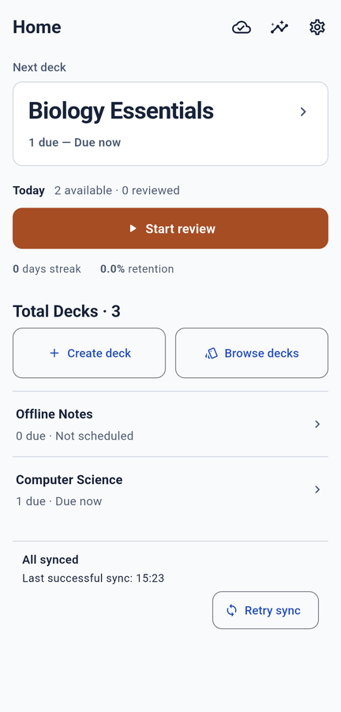
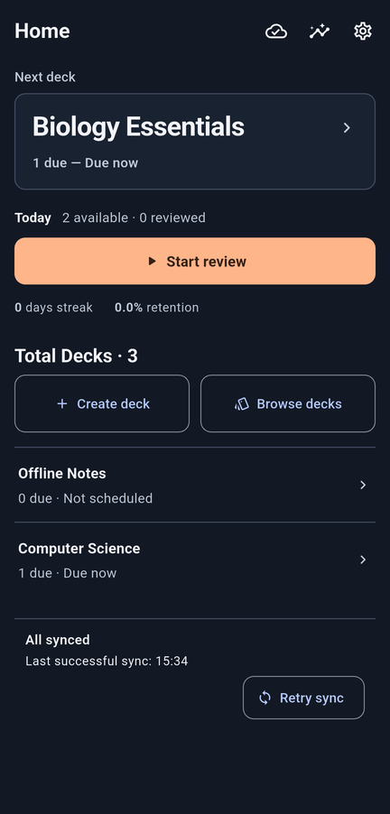
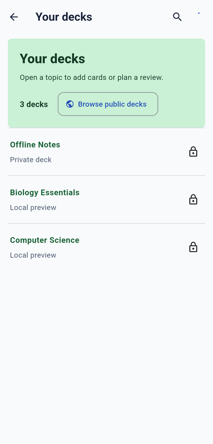
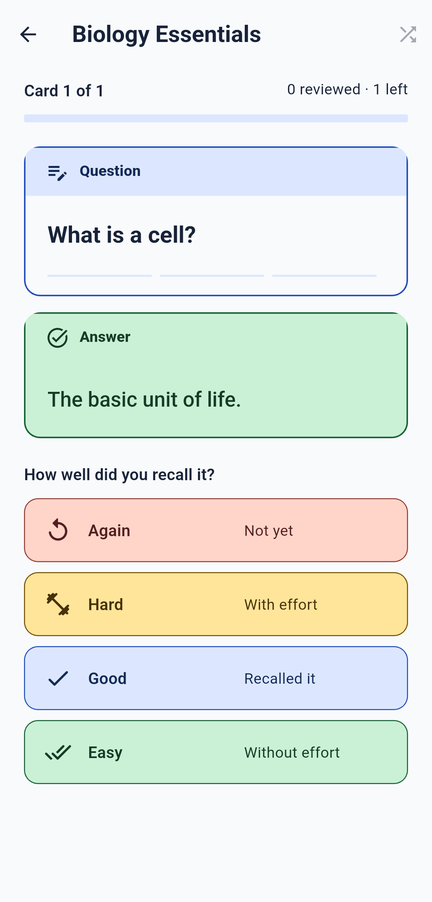
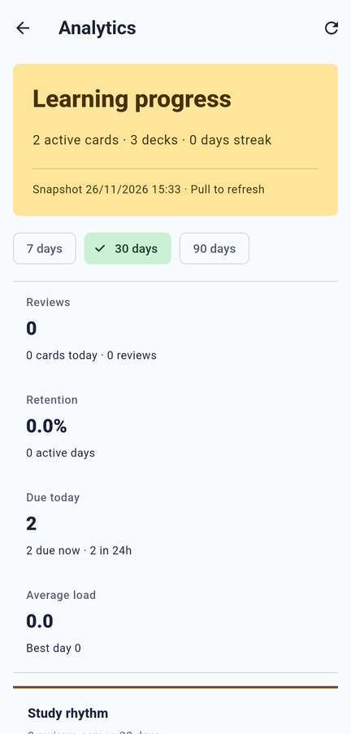
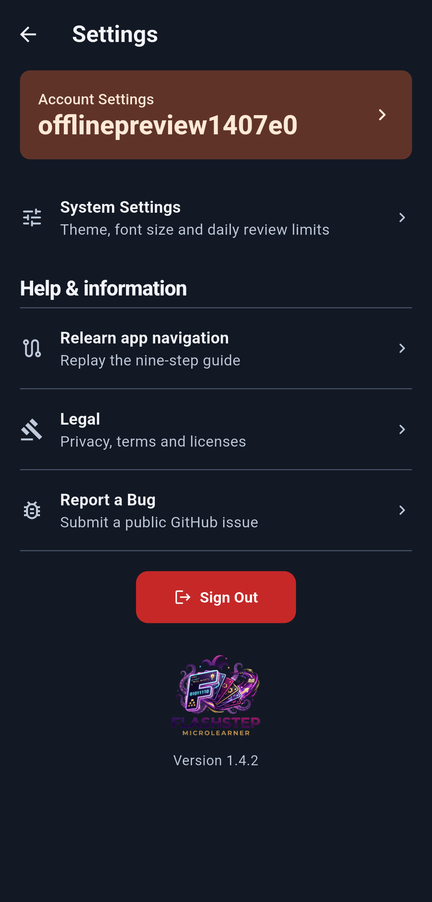

  

# Flashstep Microlearner
A local-first microlearning and flashcard app built with Flutter and Go (Gin), designed for fast review sessions, deck management, spaced repetition, sync, and learner analytics.

## What this project is

Flashstep Microlearner is a full-stack flashcard learning platform with:

- a Flutter frontend for Android and cross-platform clients
- a Go backend with PostgreSQL
- local-first data storage through Drift on the device
- cloud sync for decks, cards, review history, and analytics, including paged review-history reconciliation across devices
- spaced repetition review workflows
- public deck browsing and editable personal copies
- accessible navigation controls and responsive review settings

The goal of the project is to make short, repeatable learning sessions feel smooth, fast, and reliable, even when connectivity is inconsistent.

## App preview

Screenshots from the Android app with sample study decks. Select an image to view it at a larger size.

<table>
  <tr>
    <th>Home · Light</th>
    <th>Home · Dark</th>
    <th>Deck library</th>
  </tr>
  <tr>
    <td></td>
    <td></td>
    <td></td>
  </tr>
  <tr>
    <th>Review</th>
    <th>Analytics</th>
    <th>Settings</th>
  </tr>
  <tr>
    <td></td>
    <td></td>
    <td></td>
  </tr>
</table>

## Documentation

- [Installation Guide](INSTALL.md)
- [Release Notes 1.4.2](./docs/release-1.4.2.md)
- [Release Notes 1.4.0](./docs/release-1.4.0.md)
- [Release Notes 1.3.0](./docs/release-1.3.0.md)
- [Backend API Reference](./backend/api/API.md)
- [Architecture and Design Docs](docs/)

## License

- This project is licensed under the terms described in [MIT License](LICENSE).
- Logo images and variants were created by Roonil03 and are licensed under [CC BY-SA 4.0](./frontend/assets/LICENSE).

## Contributors:
- Project Creator and maintainer: [Roonil03](https://github.com/Roonil03)

> This project was made as part of the Advanced Technology Lab Project
